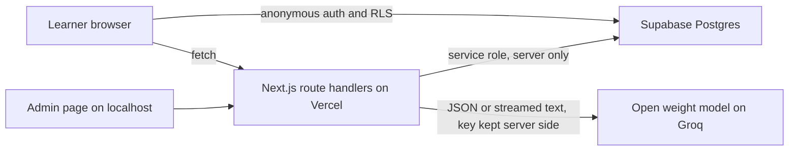

# Bruno's Mind

Unofficial AZ-900 study tool. Learn Azure through the world you already understand: matatus, mobile money, farm cooperatives and market stalls.

Built for the Vibe Coding Hackathon, AZ-900 Exam Prep Edition (#1MillionDevs).

Live demo: [PASTE LIVE URL]

Bruno's Mind is an unofficial study tool. It is not affiliated with, endorsed by, or sponsored by Microsoft. It uses no Microsoft logos. All questions are original.

## Problem

I did not understand AZ-900 at first. The notes were too abstract. A good analogy in plain language would have fixed it. Most exam prep tools add more questions but not more understanding.

## Solution

Every concept comes in three levels: a story from the learner's own world, one sentence in plain words, and the exact exam wording. Wrong quiz answers show the matching story. The learner picks a world and a language (English or Kiswahili) and the whole app retells itself.

## Screenshots


## Features

- Guided course in three units (cloud concepts, architecture and services, management and governance), 46 concepts in teaching order. Each concept: story, meaning, study note, quick check, AI tutor.
- Analogy Engine with four worlds and English and Kiswahili, cached per concept, world and language.
- Smart quiz with rounds by topic or concept, instant feedback per option, and a weak spot mode.
- Flashcard coach using a Leitner spaced repetition system that brings back what you keep missing.
- Games: Analogy Match and Layer Sort.
- Readiness dashboard with gauges by skill area and a coverage warning.
- Find my gaps: the AI names the wrong idea behind your mistakes.
- Study planner built from the exam date, weekly hours and weak areas, plus AI coach tips.
- Study Buddy chat that always starts with an analogy.
- Neural map background that reacts to answers, with a low power mode and reduced motion support.
- Admin content pipeline: question generator, accuracy checker, study note writer and a review queue.

## Architecture



## Setup on Windows with Git Bash

1. Install Node.js 20 or newer, Git and VS Code.
2. Clone and install:

```bash
git clone [PASTE REPO URL] brunos-mind
cd brunos-mind
npm install
```

3. Create a Supabase project. In the SQL Editor run these files in order: `supabase/schema.sql`, `supabase/seed.sql`, `supabase/migration_4b.sql`, `supabase/concepts_4b.sql`, `supabase/migration_10b.sql`.
4. In Supabase go to Authentication, Sign In / Providers and turn on Allow anonymous sign-ins.
5. Create `.env.local` in the project root with the variables below.
6. Run the app:

```bash
npm run dev
```

7. Open http://localhost:3000/admin, enter your `ADMIN_KEY` and click Generate all missing content. Then approve flagged questions in the review queue.
8. On the Analogies page, pick each world and click the write button so every world is filled.

## Environment variables

| Name | Public | Purpose |
|---|---|---|
| NEXT_PUBLIC_SUPABASE_URL | yes | Supabase project URL |
| NEXT_PUBLIC_SUPABASE_ANON_KEY | yes | Supabase anon or publishable key |
| SUPABASE_SERVICE_ROLE_KEY | no | Server only, used by route handlers |
| AI_API_KEY | no | Server only, key for the model provider |
| AI_MODEL | no | Model id, for example openai/gpt-oss-120b |
| AI_BASE_URL | no | Optional, defaults to the Groq OpenAI compatible endpoint |
| ADMIN_KEY | no | Local only. Do not set it on Vercel, so the admin API stays closed in production |

## Deploy to Vercel

Push to GitHub, import the repo in Vercel, add the variables above except `ADMIN_KEY`, deploy, then set the Supabase Site URL to the Vercel URL.

## Tests

```bash
npm test
```

Unit tests cover spaced repetition, the readiness score, the study planner and the question schema.

## Prompts

See [PROMPTS.md](PROMPTS.md) for every prompt, its output format, guardrails and a test input. Regenerate it with `npm run prompts`.

## Content and accuracy

- Questions are original and written from public skill outlines. No exam dumps.
- Each concept has an official summary that grounds the AI.
- AI output is validated with Zod, checked by a second AI pass, and flagged items go to a human review queue.
- Each question shows whether it is human reviewed or only AI checked.
- Skill area weights in the readiness score are placeholders to confirm against the AZ-900 study guide on Microsoft Learn.

## Limitations

- AI can be wrong. Kiswahili text needs a native speaker review.
- Anonymous accounts: progress belongs to one browser. Email sign in is not built yet.
- The page language attribute stays English when Kiswahili is selected.
- Outage Survivor and CapEx or OpEx games are not built yet.
- Study notes are English only.
- Free tier AI rate limits can slow content generation.

## Roadmap

- Magic link sign in to keep progress across devices.
- More games and more worlds.
- More languages, structured the same way as Kiswahili.
- Native speaker review tools.
- Other certifications such as AZ-104 and AWS Cloud Practitioner: add a concept table, a skills outline and worlds, nothing else changes.

## License

[CHOOSE A LICENSE, for example MIT]